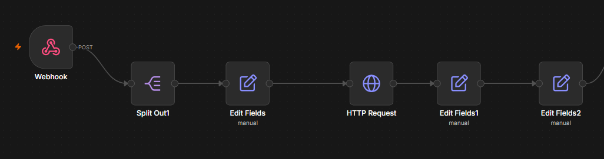
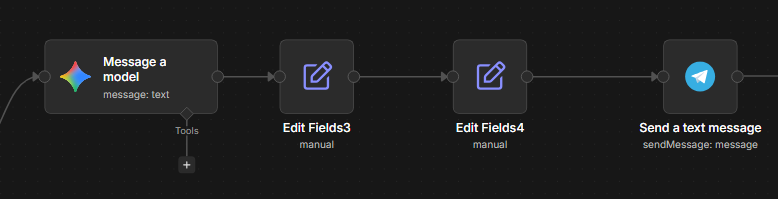
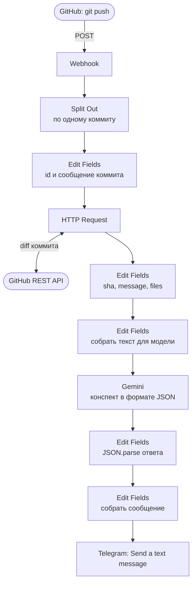

<div align="center">

# Git Diary

**Каждый `git push` превращается в короткий учебный конспект в Telegram**

n8n-workflow: GitHub webhook → diff коммита → Gemini → Telegram


[Как это выглядит](#как-это-выглядит) ·
[Как работает](#как-это-работает) ·
[Установка](#установка) ·
[Ограничения](#ограничения)

</div>

---

Я учусь и много пишу кода, но по истории коммитов сложно вспомнить, что именно я тогда понял. Этот workflow делает первую версию записи за меня: что сделано, что нового узнал, как это работает, плюс ссылка на коммит. Конспект приходит в Telegram сразу после `git push`.

> [!NOTE]
> Это учебный проект. С n8n я работаю на базовом уровне, это моя первая автоматизация. Я сознательно показываю и ограничения (раздел ниже), чтобы было видно, что я понимаю, где решение слабое.

## Содержание

- [Как это выглядит](#как-это-выглядит)
- [Как это работает](#как-это-работает)
- [Что здесь использовано](#что-здесь-использовано)
- [Установка](#установка)
- [Ограничения](#ограничения)
- [Идеи для развития](#идеи-для-развития)
- [Структура репозитория](#структура-репозитория)

## Как это выглядит

<!-- Скриншот очень широкий, поэтому лучше две картинки: ноды 1-6 и ноды 7-10. Положи их в docs/ -->
<p align="center">
  
  <br>
  
</p>

Пример сообщения, которое приходит в Telegram:

> **Что я сделал**
> Добавил валидацию формы входа и вынес проверку email в отдельную функцию.
>
> **Что я узнал**
> - Формат email проще проверять простым правилом, а правильность адреса подтверждать письмом
> - Валидацию удобнее держать отдельно от компонента
>
> **Как я это понял**
> Я вынес проверку из компонента, чтобы её можно было тестировать отдельно.
>
> **Пример**
> фрагмент кода или «Пример не нужен»
>
> **Commit**
> ссылка на коммит на GitHub

Текст в примере придуман для демонстрации формата. В реальных сообщениях его пишет модель на основе твоего коммита.

## Как это работает



<details>
<summary><b>Подробно по каждой ноде</b></summary>

| # | Нода | Что делает |
|---|---|---|
| 1 | **Webhook** | Принимает POST от GitHub при push |
| 2 | **Split Out** | Разбивает `body.commits` на отдельные элементы, чтобы каждый коммит обрабатывался отдельно |
| 3 | **Edit Fields** | Оставляет `commitId` и `commitMessage` |
| 4 | **HTTP Request** | Запрашивает у GitHub API полный коммит со списком файлов и diff |
| 5 | **Edit Fields** | Берёт `sha`, сообщение коммита и массив `files` |
| 6 | **Edit Fields** | Собирает один текст для модели: сообщение, имя файла, статус, `+/-` и diff каждого файла |
| 7 | **Message a model** (Gemini) | По промпту пишет конспект от первого лица на русском и возвращает JSON |
| 8 | **Edit Fields** | Превращает текстовый ответ модели в объект (`JSON.parse`) |
| 9 | **Edit Fields** | Формирует текст сообщения и ссылку на коммит |
| 10 | **Send a text message** | Отправляет результат в Telegram, в нужный топик группы |

</details>

<details>
<summary><b>Какой формат ответа я требую от модели</b></summary>

Промпт просит вернуть только валидный JSON, чтобы результат можно было разобрать кодом, а не читать как свободный текст:

```json
{
  "summary": "1-2 коротких предложения о том, что сделано",
  "learned": ["1-3 пункта о том, что понял", "или пустой массив"],
  "explanation": "короткое объяснение своими словами",
  "example": "небольшой пример кода или пустая строка"
}
```

В промпте также прописано: писать от первого лица, не выдумывать технологии и причины, которых нет в коммите, а если коммит тривиальный, прямо сказать, что нового материала нет.

</details>

## Что здесь использовано

- получение данных по **webhook** и разбор массива (`Split Out`);
- запросы к внешнему **REST API** (GitHub);
- **выражения n8n** для подстановки данных (`{{ $json... }}`) и небольшой JavaScript в нодах `Edit Fields`;
- **промпт для LLM** с жёстким форматом ответа (структурированный JSON) и ограничениями против выдумок;
- интеграция с **Telegram Bot API**, отправка в топик группы.

## Установка

### Что понадобится

- n8n (облако или self-hosted) с публичным адресом, который доступен для GitHub. Для self-hosted подойдёт обратный прокси или туннель;
- API-ключ Google Gemini;
- Telegram-бот (токен от [@BotFather](https://t.me/BotFather)) и ID чата.

### Шаги

**1. Импортируй workflow.** В n8n: `Workflows` → `Import from File` → выбери `workflow.json`.

**2. Подключи credentials.** Создай и привяжи:

- `Google Gemini (PaLM) API` для ноды *Message a model*;
- `Telegram API` с токеном бота для ноды *Send a text message*.

**3. Подставь свои значения.** В файле они помечены `YOUR_...`:

| Где | Что заменить |
|---|---|
| Webhook → `Path` | свой путь, лучше длинный и случайный |
| HTTP Request → URL | `YOUR_GITHUB_USER/YOUR_REPO` на свой репозиторий |
| Edit Fields (предпоследняя) → ссылка на коммит | то же самое |
| Telegram → `Chat ID` | ID твоего чата |
| Telegram → `message_thread_id` | ID топика, если в чате включены темы. Если тем нет, удали это поле |

**4. Активируй workflow** переключателем `Active`.

> [!IMPORTANT]
> Тестовый URL (`/webhook-test/...`) работает только пока в n8n нажата кнопка *Listen for test event*. GitHub нужно давать production URL (`/webhook/...`).

**5. Добавь webhook в GitHub:** репозиторий → `Settings` → `Webhooks` → `Add webhook`.

| Поле | Значение |
|---|---|
| Payload URL | production URL из ноды Webhook |
| Content type | `application/json` |
| Events | `Just the push event` |

**6. Проверь.** Сделай коммит и `git push`. Сообщение должно прийти в Telegram.

<details>
<summary><b>Как узнать Chat ID</b></summary>

Добавь бота в группу, отправь любое сообщение и открой в браузере:

```
https://api.telegram.org/bot<TOKEN>/getUpdates
```

В ответе будет `chat.id`. У супергрупп он начинается с `-100`.

</details>

> [!WARNING]
> Токен бота и ключ Gemini нельзя вставлять в поля нод и коммитить. Храни их только в credentials n8n. Если ключ всё-таки попал в публичный репозиторий, перевыпусти его.

## Ограничения

> [!CAUTION]
> Workflow учебный и не рассчитан на продакшен. Вот что в нём стоит доработать.

| Проблема | Почему так | Что делать |
|---|---|---|
| Только публичные репозитории | HTTP Request ходит в GitHub API без авторизации, лимит около 60 запросов в час | Добавить токен GitHub через credentials |
| Webhook не защищён | Любой, кто узнает URL, может вызвать его и потратить квоту Gemini | Проверять подпись `X-Hub-Signature-256` или хотя бы использовать секретный путь |
| У части файлов нет diff | Для бинарных и очень больших файлов GitHub не возвращает `patch`, в промпт попадёт `undefined` | Фильтровать такие файлы перед сборкой промпта |
| Большие коммиты | Diff может не поместиться в контекст модели, конспект получится слабым | Обрезать diff или пропускать слишком большие коммиты |
| Модель может ошибиться | LLM предсказывает вероятный текст и может выдать неточность | Читать конспект как черновик, а не как истину |
| Невалидный JSON от модели | Нода `JSON.parse` упадёт с ошибкой | Добавить ветку обработки ошибок |
| Preview-модель | `gemini-3-flash-preview` относится к preview-линейке, её название или поведение может измениться | Следить за доступными моделями |

## Идеи для развития

- [ ] Проверка подписи webhook из GitHub
- [ ] Ветка обработки ошибок (невалидный JSON, пустой diff)
- [ ] Сохранение конспектов в Google Sheets или Notion, чтобы собралась база знаний
- [ ] Фильтр: не отправлять заметки для merge-коммитов и мелких правок

## Структура репозитория

```
.
├── workflow.json      # экспорт workflow (без токенов и ключей)
├── README.md
└── docs/
    ├── workflow-1.png # скриншот, первая половина
    └── workflow-2.png # скриншот, вторая половина
```

В `workflow.json` нет токенов и ключей: все идентификаторы заменены на `YOUR_...`, credentials подключаются отдельно в самом n8n.
